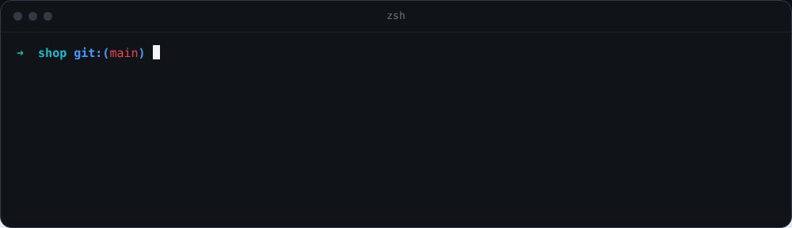

# terminalhinter

[](https://www.npmjs.com/package/@erykkozyra/terminalhinter)
[](LICENSE)

**Type three letters. Get the whole command.** Open source autocomplete for zsh, bash, fish and PowerShell on
macOS, Linux and Windows. It completes 700+ command line tools as you type, hands you the fix when a command fails,
and marks the risky ones red.



**[Watch every feature play, and try it in your browser](https://erykkozyra.github.io/terminalhinter/)**. No install
needed.

## Install

```bash
npm i -g @erykkozyra/terminalhinter
thint init
```

Then open a new terminal tab and type `git` or `cd`. `thint init` finds your shells and sets them all up, with a
backup of each config.

## Why you will like it

- **A failed command comes back fixed.** After a typo or a missing upstream, the empty line offers the fix and Tab
  takes it.
- **Red before you force-push.** Entries that delete or overwrite are red and say why. Ctrl+G explains every word
  of a line.
- **It reads your project.** Your scripts, Makefile targets, branches with the age of their last commit, the
  processes on your ports.
- **Enter walks into folders.** A few presses take you deep into a project, with the list open all the way.
- **Nothing to allow, nothing to sign up for.** No Accessibility permission, no app in the menu bar, no account, no
  telemetry.

Coming from Fig or Kiro CLI, which dropped its autocomplete in 3.0? `thint migrate` moves you over in one command.

## Contents

- [Where it runs](#where-it-runs)
- [Everything it does](#everything-it-does)
- [Keys](#keys) and [commands](#commands)
- [Coming from Kiro CLI or Fig](#coming-from-kiro-cli-or-fig)
- [Your own suggestions](#your-own-suggestions) and [snippets](#snippets)
- [Windows](#windows) and [VS Code](#vs-code)
- [Updating and uninstalling](#updating-and-uninstalling)
- [Troubleshooting](#troubleshooting)
- [Where things are kept, and what goes online](#where-things-are-kept)

## Where it runs

| System       | Shells                                                                               |
| ------------ | ------------------------------------------------------------------------------------ |
| macOS, Linux | zsh, bash, fish, PowerShell 7                                                        |
| Windows      | PowerShell 7, Windows PowerShell 5.1, Git Bash; cmd started by hand (`thint -s cmd`) |

Any terminal app works: iTerm2, Terminal.app, Ghostty, WezTerm, Kitty, Alacritty, VS Code, Cursor, Windows Terminal,
and tmux or screen inside them. zsh and bash on macOS and Linux have been around the longest; fish and Windows are
newer, so if something looks off there, [open an issue](https://github.com/ErykKozyra/terminalhinter/issues).
nushell and xonsh come from the upstream project and are not tested.

## Everything it does

### When something goes wrong

- **It offers the fix for the command that just failed.** A typo (`gti` → `git`), a missing upstream branch, a
  branch or script with a near name, a folder that needs `-p`, a port that is taken. Tab puts it on the line;
  nothing runs by itself.
- **Ctrl+G explains a line before you run it**: every word with what it means, through pipes, `&&`, redirects and
  `sudo`, with a warning for the parts that delete or overwrite things.
- **Risky entries are marked red** and say why: `--force`, `reset --hard`, `rm -r`, a Make target tagged `[prod]`,
  an ssh host called `PROD`.

### Your project

- **Your tasks:** Makefile targets with their `##` descriptions and sections, just recipes, Taskfile tasks, docker
  compose services, mise and deno tasks, package.json scripts, turbo tasks, workspace packages for `--filter`.
- **git with context:** the age and message of the last commit next to every branch, stashes by what they hold,
  the reflog after `git reset`, and your aliases complete like the command behind them.
- **Ports:** `kill` starts with the processes listening on a port, with their folder (`:3000 next dev · ~/Dev/shop`).
- **Package versions:** `npm i react@` lists the tags and the newest releases (pnpm, yarn and bun too).
- **What you ran here:** typing the first word brings back whole commands you ran in this folder, and the ones
  you ran elsewhere in the same repository. Lines that look like they hold a password or token are never stored.

### Moving around

- **Enter walks into folders.** The list stays open with what is inside; the `↪` entry runs the command where you
  are. `cd` also finds folders from anywhere through your bookmarks and zoxide.
- **→ looks inside a folder before you commit to it.** It puts the folder on the line and lists what is inside; ←
  goes back up. Enter after a walk goes straight to the highlighted folder.

### The list itself

- **It learns what you use**, and Shift+Up / Shift+Down puts the list in your own order.
- **Letters in order are enough.** `chkt` finds `checkout`.
- **Right after a space nothing is selected**, so Enter just runs the command. A word you typed in full that no
  entry starts with runs as typed too.
- **Enter can run at once:** `thint config set enterRuns true` makes Enter take the entry and run the line.


## Keys

| Key                  | What it does                                                               |
| -------------------- | -------------------------------------------------------------------------- |
| Enter                | Accept, walk into a folder, or run the command on `↪`                     |
| → ←                  | On a highlighted folder at the end of the line: look inside it, go back up |
| Tab                  | Accept the selected entry                                                  |
| ↑ ↓                  | Move the selection; ↑ with nothing selected goes to your shell history     |
| Shift+↑ ↓            | Move the selected entry in the list                                        |
| Esc                  | Hide the list until you type again                                         |
| Ctrl+Space           | Show it again                                                              |
| Ctrl+G               | What each word of the line does                                            |
| Tab on an empty line | Take the fix offered after a failed command                                |

On a Mac, Ctrl is the Control key (⌃), not Command.

## Commands

| Command              | What it does                                                   |
| -------------------- | -------------------------------------------------------------- |
| `thint init`         | Guided setup                                                   |
| `thint theme`        | Pick a theme: thint, light, nord or dracula                    |
| `thint config`       | Show or change settings ([all of them](docs/configuration.md)) |
| `thint bookmark add` | Bookmark a folder, so `cd` offers it from anywhere             |
| `thint specs new`    | Start your own suggestions for a command                       |
| `thint order reset`  | Forget an order you set with Shift+↑ ↓                         |
| `thint snippets new` | Start your snippets: commands with fields to fill in           |
| `thint migrate`      | Move over from Kiro CLI, Amazon Q or Fig                       |
| `thint update`       | Install the newest version                                     |
| `thint doctor`       | Check the installation and tell you how to fix it              |
| `thint debug keys`   | Record what your terminal sends for the keys thint uses        |

## Coming from Kiro CLI or Fig

Kiro CLI 3.0 dropped its autocomplete, and Fig is gone. terminalhinter gives you the same dropdown, locally and
without an account. `thint migrate` takes the Kiro CLI, Amazon Q or Fig lines out of your shell files (keeping a
copy of each file), and your own Fig specs in `~/.fig/autocomplete/build` can be loaded as they are.

## Your own suggestions

For in-house scripts and tools, put a YAML file in `~/.config/terminalhinter/specs`:

```yaml
name: deploy
subcommands:
  - name: staging
    args: { name: app, suggestions: [web, admin] }
  - name: logs
    args: { name: service, script: "ls services" } # every line of the output is a suggestion
options:
  - name: [--force, -f]
    description: Skip the checks
```

`thint specs check` points out mistakes. A broken file is skipped and the rest keep working.

## Snippets

Commands you type often, with fields to fill in, go in `~/.config/terminalhinter/snippets.yaml` (`thint snippets new`
starts the file):

```yaml
- name: release
  command: "git tag v{{version}} && git push --tags"
```

Type the name, fill the fields, and the finished command lands on the line.

## Windows

Run `npm i -g @erykkozyra/terminalhinter` and `thint init` in PowerShell 7 or Windows PowerShell. The setup puts
the startup lines into the profile of both PowerShells and into `~/.bashrc` for Git Bash.

Windows PowerShell 5.1 comes with scripts turned off, so it would skip its profile and the list never starts there.
`thint init` sees that and offers to allow scripts for your user only
(`Set-ExecutionPolicy -Scope CurrentUser RemoteSigned`, what PowerShell 7 has from the start). If `thint` or `npm`
themselves will not start in Windows PowerShell for the same reason, use `thint.cmd init` and `npm.cmd`.

cmd has no startup file to put the lines in, so there you start the list with `thint -s cmd`.

## VS Code

The list looks its best with these settings:

```json
"terminal.integrated.lineHeight": 1.3,
"terminal.integrated.minimumContrastRatio": 1,
"terminal.integrated.gpuAcceleration": "on"
```

`minimumContrastRatio: 1` stops VS Code from changing the colors of the list. Any monospace font works.

## Updating and uninstalling

**Updating.** `thint update`. A new tab tells you once when a new version is out; `thint config set updateCheck false`
turns that off. An update with `npm i -g @erykkozyra/terminalhinter@latest` works too: the next new tab picks it up.

**nvm.** The list in your tabs never depends on your Node version, because thint carries its own runtime. Only the
`thint` command you type is a global npm package: after you switch your default Node, run
`npm i -g @erykkozyra/terminalhinter` once more so that version has the command too.

**From source** (needs Node 18+ and git, only for the build):

```bash
git clone https://github.com/ErykKozyra/terminalhinter.git
cd terminalhinter
./scripts/install-from-source.sh
```

This puts a single binary in `~/.local/bin/thint` that does not depend on Node at all.

**Uninstalling.**

```bash
thint uninstall
npm rm -g @erykkozyra/terminalhinter
```

`thint uninstall` takes the startup lines out of every shell config and removes thint's files. `thint init --remove`
only takes the startup lines out.

## Troubleshooting

Start with `thint doctor`. It checks the install, the startup lines of each shell and your config, and says how to
fix what it finds.

**A new tab has no list.**
The startup lines are missing or something stops them. Run `thint init` again; it replaces old lines instead of
adding a second copy. `thint -c` tells you whether the current shell runs inside terminalhinter.

**Windows PowerShell: "running scripts is disabled on this system".**
Scripts are off in Windows PowerShell 5.1 by default, which stops both `thint` (npm's `thint.ps1`) and the profile.
Run `thint.cmd init` and say Yes when it asks to allow scripts, or run
`Set-ExecutionPolicy -Scope CurrentUser RemoteSigned` yourself. A policy set by your company wins over it; then use
PowerShell 7 or Git Bash.

**The tab opens with "thint could not start".**
thint failed and left you a plain shell instead of closing the tab. The message says why; `thint reinit` unpacks
thint's files again, which fixes most of these.

**After updating with pnpm, new tabs still start the old version.**
Run `thint reinit` once. This hits only updates from 1.1.3 and older made with `pnpm add -g` by hand; `thint update`
does it for you.

**Ctrl+Space does nothing, or switches the keyboard layout.**
macOS uses Control+Space to switch input sources when you have more than one: turn that shortcut off in System
Settings › Keyboard › Keyboard Shortcuts › Input Sources. In another terminal, `thint debug keys` records what it
sends; attach the file to an issue.

**→ accepts the gray suggestion of my shell instead of looking into the folder.**
zsh-autosuggestions, fish and PowerShell show their own gray guess after the cursor. thint only takes → on a
highlighted folder at the end of the line; to leave → to your shell always, run `thint config set folderArrows false`.

**Enter runs the command instead of taking the entry.**
Right after a space nothing is selected, so Enter runs what you typed. Press ↓ or Tab to take an entry.
`thint config set enterRuns true` makes Enter take the entry and run the line at once.

**The colors of the list look washed out in VS Code.**
Set `"terminal.integrated.minimumContrastRatio": 1`; VS Code otherwise changes the colors it draws.

**New tabs open slowly, or something in my config runs twice.**
thint starts a fresh shell inside itself, so anything above the startup lines loads twice. `thint doctor` counts those
lines; `thint init` moves the startup lines back to the top.

**Old Kiro CLI, Amazon Q or Fig lines are still in my shell config.**
`thint migrate` takes them out and keeps a copy of each file.

**Something else.**
Start a tab by hand with logging on, for example `thint -s zsh -V`, do what goes wrong, and attach
`~/.local/share/terminalhinter/log/terminalhinter.log` (on Windows `~\.terminalhinter\log\terminalhinter.log`) to
[an issue](https://github.com/ErykKozyra/terminalhinter/issues), with the output of `thint doctor`.

## Where things are kept

| What                                 | Where                                                                                                                                              |
| ------------------------------------ | -------------------------------------------------------------------------------------------------------------------------------------------------- |
| Settings                             | `~/.terminalhinterrc` or `~/.config/terminalhinter/rc.toml` ([all settings](docs/configuration.md))                                                |
| Your specs and snippets              | `~/.config/terminalhinter/specs/`, `~/.config/terminalhinter/snippets.yaml`                                                                        |
| What it learned, logs, its own files | `~/.local/share/terminalhinter` (`~/.terminalhinter` on Windows and older installs)                                                                |
| Startup lines                        | the top of `~/.zshrc`, `~/.bashrc`, `config.fish` or your PowerShell `$PROFILE`, between `# >>> terminalhinter >>>` and `# <<< terminalhinter <<<` |

There is no telemetry. What you type and what thint learns stay in these folders. It goes online only to look up
packages: once a day it asks npm for its own newest version number (`updateCheck = false` turns that off), and when you
type a package name or `react@` it asks the npm registry and the npms.io package search for matches, sending only that word.

## Credits

A fork of [microsoft/inshellisense](https://github.com/microsoft/inshellisense), with command specs from
[withfig/autocomplete](https://github.com/withfig/autocomplete). Most of the hard work lives there. Not
affiliated with Microsoft, Amazon or Fig.

[MIT License](LICENSE)
