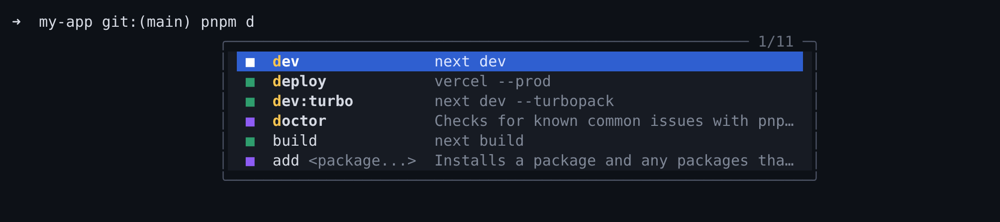

# terminalhinter

IDE-style autocomplete for your terminal, with the navigation people liked in Fig and Kiro CLI:
a dropdown under the cursor for folders, git branches, npm scripts and subcommands of 600+ CLIs,
each with a short description.



The command is `thint` (long form: `terminalhinter`).

> **Status:** used daily on macOS with zsh and oh-my-zsh. Linux (bash, zsh) is tested.
> Windows and fish are experimental: they work in the upstream project but are not yet tested with this fork.

## What it does

- **The list is in your order.** Select an entry and press Shift+Up or Shift+Down to move it. The list remembers
  that order for that spot in the command (after `pnpm`, after `git checkout`), also through aliases (`p` for
  `pnpm`). `thint order reset` forgets it.
- **Walk into folders with Enter.** Enter on a folder inserts it and keeps the list open with its
  contents. The `↪` entry at the top runs the command, so `cd` + Enter, Enter, Enter lands you deep in a tree.
- **Descriptions and argument hints** for subcommands and options, e.g. `checkout [branch, file, tag or commit]`.
- **Your aliases and functions**, with what each alias expands to and which file a function comes from.
- **Learns what you use.** Folders, branches, scripts and subcommands you pick often move up, recent ones more
  than old ones.
  An exact match still comes first (`pnpm dev` offers the `dev` script before `dev:vite`). The history stays on
  your machine in `~/.local/share/terminalhinter/history.jsonl`.
- **Forgiving matching.** Letters in order are enough: `icpl` finds `intercars.com.pl`, `chkt` finds `checkout`.
- **Knows your project.** `pnpm --filter`, `turbo run --filter` and `yarn workspace` suggest your workspace
  packages; `turbo run` suggests the tasks from `turbo.json`; git branches show the age and subject of their last commit.
- **Jump anywhere with `cd`.** `cd` offers your bookmarks and most used folders from any directory
  (`thint bookmark add`).
- **Your own suggestions** for in-house scripts and tools, in a few lines of YAML (`thint specs new`).
- **Themes.** `thint theme` with a live preview: thint, light, nord, dracula.
- **Stays out of the way.** Right after a space nothing is selected, so Enter just runs the command.
  `git checkout -` and `cd -` run immediately.
- **A clean, modern list.** Each entry shows its description in a column next to the name, the selection is
  a highlight inside the card, and a colored square tells the kind of entry. No special fonts: everything is
  made of characters every terminal font has. Folders come first, hidden entries
  last, and files are tinted by kind (code, config, styles, images).
- **Independent of your Node version.** The binary carries its own runtime, so switching Node with nvm never breaks it.
- **Your terminal tab still says `zsh`.**

## Install

With npm (macOS, Linux; Windows is experimental):

```bash
npm i -g @erykkozyra/terminalhinter
thint init
```

`thint init` asks for your shell, theme and icons, then puts the startup lines at the top of your shell
config. Open a new terminal tab afterwards.

If you use nvm (or another Node version manager): global npm packages belong to one Node version, so after
switching the default version the `thint` command is gone until you run `npm i -g` again. Suggestions in new tabs
keep working in the meantime. To avoid this, install from source instead; that build does not depend on Node at all.

From source (needs Node 18 to 22 and git, only for the build):

```bash
git clone https://github.com/ErykKozyra/terminalhinter.git
cd terminalhinter
./scripts/install-from-source.sh
```

The script builds a single binary, installs it as `~/.local/bin/thint`, adds `~/.local/bin` to your `PATH`
and puts the startup line at the top of `~/.zshrc`. Open a new terminal tab afterwards.

For other shells, or to pick a theme and icons first, run `thint init`: a short guided setup with a live
preview that ends by putting the startup lines at the top of your shell config (a backup is kept).

To remove it: `./scripts/uninstall-local.sh`. It also takes the startup block out of `~/.zshrc`
(`thint init --remove` does only that part).

### Fast startup

The startup line belongs at the **top** of `~/.zshrc`. terminalhinter starts a fresh shell inside itself,
so anything above the line loads twice. The install script puts it there for you.

If you use nvm, loading it lazily saves another half a second per tab.

## Usage

| Key | Action |
| --- | --- |
| Enter | Accept the selected suggestion; on a folder, walk into it; on `↪`, run the command |
| Tab | Accept the selected (or first) suggestion |
| Up / Down | Move the selection; Up with nothing selected goes to shell history |
| Escape | Close the list |
| Ctrl+Space | Open the list again (or close it) |
| Shift+Up / Shift+Down | Move the selected entry; the list keeps your order next time (also Alt+Up / Alt+Down) |

Commands:

```bash
thint init                  # guided setup: shell, theme, icons
thint theme                 # pick a theme with a live preview (or: thint theme nord)
thint config list           # every setting and its value
thint config set maxSuggestions 8
thint bookmark add . -n api # `cd api` from anywhere
thint specs new deploy      # start your own suggestions for a command
thint order list            # the orders you set with Shift+Up / Shift+Down
thint doctor                # check the installation, with a fix for every problem
thint reinit                # regenerate resources after an update
thint -c                    # is this shell running inside terminalhinter?
```

### Your own suggestions

Every file in `~/.config/terminalhinter/specs` describes one command, in YAML or JSON:

```yaml
name: deploy
description: Deploy our apps
subcommands:
  - name: staging
    args: { name: app, suggestions: [web, admin] }
  - name: logs
    args: { name: service, script: "ls services" } # each output line is a suggestion
options:
  - name: [--force, -f]
    description: Skip the checks
```

`thint specs check` reports mistakes in these files. A broken file is skipped, the rest keep working.

## Configuration

Settings live in `~/.terminalhinterrc` or `~/.config/terminalhinter/rc.toml` (TOML). `thint config set`
changes one without touching the rest; by hand, top-level keys go before any `[section]`. A broken file
never closes your terminal: you get a warning and the defaults.

```toml
theme = "thint"                         # "thint", "light", "nord" or "dracula"
useAliases = true                       # suggest your shell aliases (default: true)
maxSuggestions = 10                     # rows visible at once (default: 6)
enterAcceptsSuggestion = true           # false: Enter always runs, accept with Tab only
fuzzyMatching = true                    # letters in order are enough (default: true)
showHints = true                        # short tips in the list, e.g. that Shift+Up/Down reorders it
iconStyle = "plain"                     # "plain" (colored squares), "marks", "badge" or "nerd" (needs a Nerd Font)
boxBackground = true                    # the list sits on its own background, like a card
argumentHints = "selected"              # hints like [branch]: "selected" (only the selected row), "all", "none"
activeSuggestionBackgroundColor = "#2F5FD0" # optional, overrides the theme
borderColor = "#4B5263"                 # optional, overrides the theme
boxBorderStyle = "rounded"              # or "square"

[bindings.acceptSuggestion]
key = "tab"

[bindings.nextSuggestion]
key = "down"

[bindings.previousSuggestion]
key = "up"

[bindings.dismissSuggestions]
key = "escape"
```

There is no inline "ghost text" on purpose: zsh-autosuggestions already does that well, and the two would
draw over each other.

### Looking good in VS Code

The list looks the way it was designed with a little more room between lines and with VS Code's own color
adjustment turned off. In `settings.json` (Command Palette: "Preferences: Open User Settings (JSON)"):

```json
"terminal.integrated.lineHeight": 1.3,
"terminal.integrated.fontSize": 13,
"terminal.integrated.minimumContrastRatio": 1,
"terminal.integrated.gpuAcceleration": "on"
```

- `lineHeight` gives the rows air; this makes the biggest difference.
- `minimumContrastRatio: 1` stops VS Code from changing the colors of the list (by default it brightens dim
  text and shifts colors to raise contrast).
- `gpuAcceleration` draws the box and its backgrounds crisper.

Any monospace font works. A modern one such as JetBrains Mono looks closest to the screenshots:
`"terminal.integrated.fontFamily": "JetBrains Mono"`.

## Supported shells

bash, zsh, fish, PowerShell (pwsh and Windows PowerShell), xonsh and nushell, plus cmd (experimental).
The fork's changes are tested on zsh and bash so far.

## Credits

terminalhinter is a fork of [microsoft/inshellisense](https://github.com/microsoft/inshellisense) by
Microsoft, released under the MIT License. The command specs come from
[withfig/autocomplete](https://github.com/withfig/autocomplete) (MIT). Thanks to both projects; most of
the hard work lives there.

This project is not affiliated with or endorsed by Microsoft, Amazon (Kiro) or Fig.

## License

[MIT](LICENSE)
